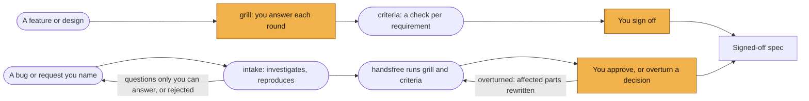
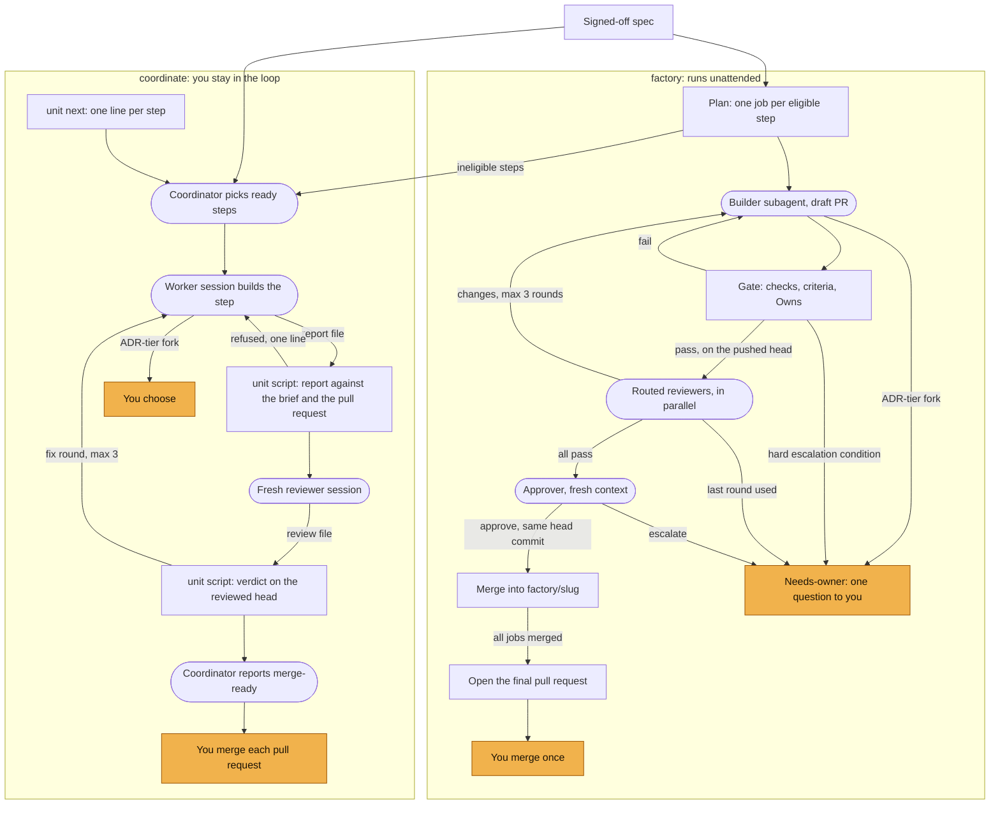
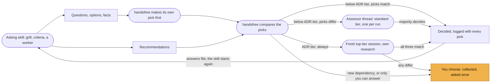

# skills

Portable coding-agent setup: skills, always-on rules, review personas and
hooks, packaged as one plugin, `jz`, in a marketplace that Claude Code and
Codex both read. Add the marketplace on any machine and the agents behave the
same.

A skill loads when you type its command, `/jz:verify` or `/jz:pr`, or when
the brief that starts a session names it. A plain request such as "commit"
does not load one on its own, which is why a hook denies a commit, push or
PR create until `pr` is loaded. The rules, the personas and the hooks load
with the plugin.

---

## Install

Requirements: `bash`, `git` and `python3` on the machine that runs the hooks,
and an authenticated `gh` for the skills that push, open or review pull
requests. `statechart` also needs Node 22.18 or later, and Java plus TLC
installed once through mise; it prints the command when they are missing.

### Claude Code

In a session:

```text
/plugin marketplace add yeojz/skills
/plugin install jz@yeojz-skills
```

Or from a shell:

```bash
claude plugin marketplace add yeojz/skills
```

```bash
claude plugin install jz@yeojz-skills
```

Start a new session so the rules and hooks load. Claude Code leaves
auto-update off for third-party marketplaces, so to pick up new commits run
`claude plugin marketplace update yeojz-skills` and then `claude plugin update jz@yeojz-skills`,
or turn auto-update on for the marketplace under
`/plugin`.

#### Settings for long runs

A plugin cannot change your settings, so these go in your own
`~/.claude/settings.json`. They are optional; without them a long
`coordinate`, `factory` or `handsfree` session still continues after a
compaction, it only grows larger first.

```json
{ "autoCompactWindow": 200000 }
```

| Setting | Effect |
|---|---|
| `autoCompactWindow` | Compacts the session once its context reaches this many tokens, from 100000 to 1000000. `/autocompact 200k` sets it from inside a session, for the current model |
| `idleCompaction` | Compacts a large conversation while it sits idle, which is the quiet moment between turns. On by default; leave it on |
| `CLAUDE_CODE_AUTO_COMPACT_WINDOW`, an environment variable | The same window for a cloud environment or a script, where there is no settings file of yours. It wins over the setting |

Compacting early is safe here because a run's state is on disk: see
[Hooks](#hooks).

### Codex

```bash
codex plugin marketplace add yeojz/skills
```

```bash
codex plugin add jz@yeojz-skills
```

Then start a new session. `codex plugin marketplace upgrade` refreshes the
snapshot after new commits. On Codex CLI 0.164.0 the skills load as
`jz:<name>`. Codex runs a plugin's hooks only after you trust them once, from
`/hooks` in an interactive session; until then the rules do not arrive at
session start, and `make-agents-md.sh` below writes them into the
repository's `AGENTS.md` instead.

---

## Use it

### A first session

Open a session in a project. The house rules arrive at session start as a
block headed "House rules from the jz plugin", with the project's own
`CLAUDE.md`, `AGENTS.md` and `CONTRIBUTING.md` surfaced beside them. Then:

1. Settle what to build. `/jz:grill` interviews the plan until nothing is
   assumed and, in spec mode, writes a spec of requirements and steps.
   `/jz:criteria` then writes acceptance criteria for each requirement, seen failing before
   anything is built. `/jz:review` in audit mode reads the repo without editing it and
   writes a plan file under `docs/plans/`, which is never committed.
2. Build it. `/jz:implement` builds a spec step or a plan item, running its
   criteria before, during and after, writing tests first.
   `/jz:debug` takes a bug cause first.
3. Prove it. `/jz:verify` runs the repo's own scripts and ends in a
   Verification block with a `behaviour` row. Without that block nothing is
   done.
4. Ship it. `/jz:pr`, with the mode in the request: "commit" stops at the
   commit, "commit and push" at the push, "commit, push and open a draft PR"
   at the draft, and "... and mark ready" runs through to ready. The body is
   written from the diff. A commit or push typed before the skill is loaded
   is denied, with the call that unblocks it.
5. Review it. `/jz:review` on a branch or a PR number; "check the PR comments"
   sweeps the unresolved threads.
6. After the merge, "PR 12 merged, clean up" runs the `pr` cleanup: the tip
   checks, the branch and worktree removal, and the main checkout brought
   level with the remote.

A spec's steps run through `/jz:coordinate` from a session in the target
repository. It starts one worker session per step and one reviewer per PR,
reports one line per PR at merge-ready, and leaves the merge to you. Its
`unit` script holds the run's state and checks each report and review from
files, so the session can run for a long time and pick up after a
compaction from one command.

Two more ways to run a spec, for when you would rather not be in the loop:

- `/jz:factory docs/specs/<slug>.md` runs every eligible step unattended.
  Scripts hold the state and the pass or fail verdict, each step is built,
  gated, reviewed and approved by fresh subagents, and the step pull
  requests merge into `factory/<slug>`. You merge one final pull request.
  A step with an owner review gate, an inspection-only criterion or no
  criterion stays with `coordinate`.
- `/jz:handsfree <command>` wraps any of these commands and answers its
  design questions in your place, as a second assessor: `handsfree grill`,
  `handsfree coordinate docs/specs/<slug>.md`. A new dependency, a sign-off,
  a merge and a question only you can answer still come to you.
- `/jz:intake` takes a bug or request you name, investigates and reproduces
  it, runs `grill` and `criteria` through `handsfree`, and shows you one
  finished spec to approve or overturn by decision number.

### Set up a project

The skills read these from the project. Each one is optional, and the skill
says what it does without it.

| In the project | Read by | Without it |
|---|---|---|
| `.claude/` in `.gitignore` | `pr` Worktree section | `pr` offers to add it to `.git/info/exclude` before creating a worktree; the hook refuses to stage `.claude/` or `docs/plans/` either way |
| `AGENTS.md` with a `## Standing orders` section | `coordinate`, pasted verbatim into every brief | the phase template's default block stands in, and adding the section is part of the first phase |
| `AGENTS.md` with an `## Enforcement` table | `improve` | the first project-side `improve` run creates it |
| `VERIFICATION.md` at the root, or one per package | `verify`, for the `behaviour` row | the row reads what the test runs support, `unit-only` at most, unless another pasted run drove the feature |
| `docs/specs/<slug>.md`, `CONTEXT.md`, `docs/adr/` | written by `grill` in spec mode, criteria added by `criteria`, read by `implement`, `coordinate` and `factory` | `implement`, `coordinate` and `factory` refuse a spec whose criteria are not signed off and offer `criteria` |
| `factory.json` at the root | `factory`, read from the base branch, to override concurrency, rounds, protected paths, reviewer routing or the checks the gate runs | the defaults in the skill's `config.json` apply, and the gate detects the declared scripts itself |
| Scripts named `format`, `lint`, `typecheck`, `test` and `build` in `package.json`, or the same targets in a `Makefile` | `verify` | the concern is reported as "no script"; nothing is invented in its place |

---

## What is in here

```
.claude-plugin/marketplace.json   the marketplace, for Claude Code
.agents/plugins/marketplace.json  the same marketplace, for Codex
plugins/jz/                       the agent-agnostic plugin
  plugin.json                     the portable manifest, for Codex
  .claude-plugin/plugin.json      the same manifest, for Claude Code
  skills/      loaded on demand when a request matches the description;
               a skill that fills in a template carries it as template.md
  rules/       always on, injected at session start by a hook
  agents/      four read-only review personas the review skill's audit mode fans out to
  hooks/       the hook scripts and the hooks.json that wires them up
```

### Skills

Sixteen skills, in three groups. The workflow runs in this order:

```
grill  ->  criteria  ->  implement  ->  verify  ->  pr  ->  review
what and    how we'll     build it        prove it     ship it  second
steps       know it's     against them                          opinion
            done
```

`grill` settles what to build and writes a spec of requirements and steps.
`criteria` writes how each requirement will be proven, and sees each check
fail before anything is built. `implement` builds a step at a time against
those criteria, `verify` gates every done claim, `pr` ships it as a draft
PR structured by requirement, and `review` gives an independent read.
`coordinate` drives a spec's steps through that loop with one fresh session
per step and per review, and `handoff` carries the state when the work
moves to another session.

A signed-off spec can run two ways. `coordinate` keeps you in the loop and
you merge each pull request. `factory` runs unattended and you merge once:

```
grill -> criteria -> coordinate          you merge every step
grill -> criteria -> factory             you merge one final pull request
intake -> factory                        you approve one spec, then merge
handsfree <command>                      any of the above, with the design
                                         questions answered for you
```

Two ways in, one spec out. Rounded boxes are agents, plain boxes are scripts
or files, and the shaded boxes are where the run waits on you:



The same spec, driven two ways:



How `handsfree` answers a question for you:



#### Workflow

| Skill | Use it for |
|---|---|
| `grill` | Interview a plan until nothing is assumed; in spec mode write the spec (requirements, decisions, vertical-slice steps), the glossary, ADRs and standing orders as decisions land |
| `criteria` | Write acceptance criteria per requirement (scenario, what counts as passing, and a test, command, drive or inspection check), run each once to see it fail, and get the owner's sign-off |
| `implement` | Build a spec step or plan item: see its criteria fail, write tests first, build the least change, record each criterion's status, checkpoint per item |
| `verify` | The completion gate: runs the repo's own scripts cheapest first, pastes output and exit codes, reports one row per concern and per criterion and the behaviour level reached, and raises coverage to a threshold with the per-file table |
| `pr` | Verify, commit, push and open a draft PR with a body written from the diff, structured by requirement when there is a spec; ready only when asked; rebase when the default branch moves; clean up after the merge |
| `review` | Change review with design, maintainability, guard-deletion and criteria lenses that always report; audit mode for a whole repo or a plan, fanned out to personas into a plan file; the PR comment and red-CI sweep; an adversarial mode across two model families |
| `coordinate` | Drive a spec's steps to merge-ready: one fresh worker per step with the step's criteria and behaviour target as Done means, one fresh reviewer per PR, bounded fix rounds, and two ledgers that only its `unit` script writes: the script checks each report and verdict from files and prints what is next in one line per step |
| `factory` | Run a signed-off spec unattended: a job per eligible step, a script that owns every stage and refuses an unsupported move, a gate script that runs the checks and criteria from the base branch, reviewers routed by risk and surfaces, an approver, a sha-pinned merge into `factory/<slug>`, and one final pull request for the owner |
| `handsfree` | Wrap any command and answer its design questions in the owner's place: its own pick before reading the recommendation, a second opinion from another model once per round, all three picks matching at the ADR tier, every decision numbered and logged; never a sign-off, a merge or a new dependency |
| `intake` | Turn a bug or request the owner names into a spec for one approval: investigate and reproduce, run `grill` and `criteria` through `handsfree`, show one screen with every decision, and rewrite what an overturned decision affects |
| `handoff` | Write a resumable handoff when work moves to another session or a person, with decisions read from the `coordinate` ledger rather than from memory |

#### Task

| Skill | Use it for |
|---|---|
| `debug` | Reproduce, instrument, trace to the root cause, a failing test first, one fix at a time |
| `guard-deps` | Advisories, action pinning, supply-chain settings, vetting a new dependency |
| `statechart` | Check a TLA+ model of a flow or protocol with TLC and draw it as a Mermaid statechart, with the shortest path to each broken rule; vendored from pstack, needs Node 22.18+ and Java plus TLC installed once through mise |
| `sync-docs` | Bring READMEs, guides and doc comments back in line with the code |

#### Self-improvement

| Skill | Use it for |
|---|---|
| `improve` | Corrections that came back, from the session transcript, review threads and reverts: proposed as edits to a skill or rule in this plugin behind an approval by number, or fixed in the project at the highest level that holds, with the check proven red on the past mistake and an enforcement row |

`verify` is the one the others depend on. It is what stops "done" from meaning
"probably done".

`review`'s audit mode fans out to the four personas under `agents/`, which install as the
subagent types `jz:principal-engineer`, `jz:security-engineer`,
`jz:test-engineer` and `jz:technical-writer`.

### Rules

Always-on and deliberately short, because they cost tokens in every session.
A plugin cannot ship rule files directly, so the `load-house-rules.sh` hook
injects them at session start.

| File | Covers |
|---|---|
| `house-style.md` | TypeScript and general code style |
| `prose.md` | Numbered writing rules, so a steer can cite "prose rule 4": plain facts, no narrative of earlier runs, no mannered phrasing, sentence-case headings, straight quotes, no emoji or model names |
| `git-workflow.md` | Branching, worktrees, commits, PR bodies, what never gets staged |
| `verification.md` | Evidence before assertions, root cause over workaround |
| `ui-conventions.md` | Icons, primitives, type scale, the checks before a layout is done |
| `parallelism.md` | Fan independent work out to subagents by default; wait for the owner only at a lettered design fork, a remote write that asks, an action the brief marks as theirs, or a skill's own pause; log each decision in the flow's ledger as it is agreed |
| `models.md` | Host-neutral model tiers mapped to Claude and Codex: grilling, coordination, implementation, review on the other family first, fix escalation and scans |

### Hooks

Some rules are enforcement problems, and a rule can be ignored while a hook
cannot. `hooks.json` wires these up with `${CLAUDE_PLUGIN_ROOT}`, which Codex
also sets.

| Hook | Event | Effect |
|---|---|---|
| `guard-bash.sh` | PreToolUse on Bash | Runs every guard in `guards/` over the command text. A guard that denies ends the call with its reason; the guards that ask are joined into one confirmation |
| `load-house-rules.sh` | SessionStart | Injects the rule files as context, since a plugin cannot ship always-on instructions |
| `load-project-rules.sh` | SessionStart | Surfaces `CLAUDE.md`, `AGENTS.md` and `CONTRIBUTING.md` at session start |
| `pre-compact.sh` | PreCompact | Tells the compaction summary to keep the branch, the task list, decisions not yet logged, the owner's open questions and each run a skill is driving, and names the folder of each flow this session marked as running. Writes no file and never blocks |
| `resume-after-compact.sh` | SessionStart, matcher `compact` | After a compaction, has the session confirm its branch, log what the summary marked unlogged, and continue each flow it marked as running from the flow's folder and its skill's Resume paragraph |

`coordinate`, `factory`, `handsfree` and `intake` each write a `flow.md` in
their folder under `docs/plans/` when the run starts, and again in a session
that picks the run up: the flow's name, `state: running` and the session's
id. The hooks name a folder only when its marker carries the id of the
session that is compacting, and print nothing else from the file. Where a
run stands is in its ledgers, so the work continues after an
auto-compaction with no handoff.

That makes compaction cheap, and compacting early is what keeps a long
coordinating session small:
[Settings for long runs](#settings-for-long-runs) has the two settings.

Codex has no documented PreCompact event, so there the two hooks do not run;
the flows still write `flow.md` and keep their ledgers, and `coordinate`
hands off at 55% context use.

The guards, each a module in `hooks/guards/` with a `NAME` and a
`check(context)` that returns nothing, a `Deny` or an `Ask`:

| Guard | Effect |
|---|---|
| `protect-default-branches` guard | Blocks a `git push` that names `main`, `master`, `develop`, `trunk` or the branch `origin/HEAD` names, pushes every branch (`--all`, `--branches`, `--mirror`), picks its target with `--repo` or a wildcard, or runs with a protected branch checked out; and blocks merging a pull request: `gh pr merge` in any form, and the REST and GraphQL merge calls through `gh api`. The owner merges on GitHub |
| `rebase-not-merge` guard | Blocks any `git merge` other than `--ff-only` or `--abort`, and any `git pull` without `--rebase`; rebase instead |
| `require-pr-skill` guard | Denies `git commit`, `git push` and `gh pr create` until the session's transcript shows the `pr` skill loaded, by a Skill call whose result reported no error or a typed `/jz:pr`; a payload without a transcript path passes, so the gate holds on Claude Code only |
| `no-claude-artifacts` guard | Blocks any `git add`, `stage` or `commit` while an unignored, modified or staged path under `.claude/`, `docs/plans/` or `.plans/` is in the repository; the fix is the exclusion the house rule asks for |
| `confirm-remote-writes` guard | Asks before a `gh pr create` without `--draft`, `gh pr ready` and any force push not pinned to a sha, including a bare `--force-with-lease`, `-f` clusters and a `+refspec`; a branch push, a draft PR and a `--force-with-lease=<branch>:<sha>` push pass without a prompt |
| `scan-secrets-before-push` guard | Scans the commits on `HEAD` that no remote has, with betterleaks or gitleaks when one is on PATH and a builtin set of token shapes otherwise, and asks before any `git push` when something looks like a secret; nothing is installed |

The guards read the command as text. Each asks whether the line mentions
`git` or `gh` and the operation it cares about, as whole words, and nothing
more: there is no shell parser and no option table. A commit message that
happens to say "merge main" is denied until it is rephrased, which costs a
retry and errs on the safe side; a line that spells `git` in a way the
regex cannot see is the deliberate shape this guardrail does not try to
stop. What a guard needs to know about the repository it asks git directly,
in the directory the payload names, with the repository's filesystem
monitor, hooks and signature display off. Every outcome is a deny, except
the two confirmations, because a host that answers prompts itself treats an
ask as advice rather than a stop. `JZ_GUARDS=<name>,<name>` restricts a run
to the guards named, which is how the suite tests one at a time.

The hooks have their own regression suite, which builds throwaway repos and
feeds the Bash guard the payloads it will see, one guard at a time. Exit 2
denies a tool call, exit 0 allows it, and an ask decision is read from the
output. The `factory` and `coordinate` scripts each have a suite of the same
kind, and `make test` runs all three.

```bash
make test
```

`make validate` runs those suites, along with checks over the marketplace
and plugin manifests, every skill, rule, agent and template, that every
hook and script is executable and compiles, `claude plugin validate` over
the marketplace and the plugin when the Claude Code CLI is installed, a 300-line limit on
every skill, and a check that every skill is listed in this README. Run it before
committing a change here.

---

## Rules as an AGENTS.md block

An agent that reads an instruction file in the repository rather than loading
plugins can still get the rules:

```bash
./make-agents-md.sh ~/code/some-project
./make-agents-md.sh --dry-run ~/code/some-project
./make-agents-md.sh --help
```

That writes every file in `plugins/jz/rules/` except `models.md` into `AGENTS.md` in the target
repo, between delimiter comments. Re-running replaces only the generated block,
so anything you wrote by hand around it survives. Edit the rules here and
re-run to update.

The agent personas under `agents/` are ordinary prompts, and the templates are
ordinary markdown, so pointing another agent at one works by hand.

---

## Working on this repo

Read [AUTHORING.md](AUTHORING.md) before adding or editing anything. It defines
the layout, the skill, rule, agent and template formats and the house facts
every skill assumes. [CONTRIBUTING.md](CONTRIBUTING.md) has the pull request
checklist.

Each skill carries `evals/evals.json`, a transcript-review checklist of prompts
and observable expectations. `validate.sh` enforces its structure, so behaviour
changes can be checked rather than guessed at.

---

## License

MIT. See [LICENSE](LICENSE).
